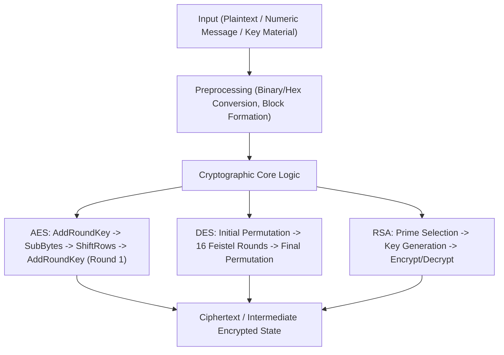

# Cryptography Algorithms in Python: AES, DES, and RSA

This repository implements foundational cryptographic algorithms in Python to demonstrate how symmetric and asymmetric encryption workflows are built from first principles.


## Overview

This project contains standalone Python implementations of:
- RSA public-key cryptography (`RSA.py`)
- DES block cipher encryption/decryption (`DES.py`)
- A stepwise AES round workflow (`AES/AES.py`)

The core problem addressed is understanding how secure message transformation works at the algorithmic level, beyond black-box library calls. This matters for security engineering, protocol literacy, and systems thinking in modern software platforms where confidentiality, integrity, and trust boundaries are critical.

## Features

- Implements both symmetric (AES, DES) and asymmetric (RSA) cryptography paradigms
- Demonstrates bitwise operations, permutations, substitution boxes, and key scheduling
- Includes full DES encryption/decryption round flow
- Includes RSA key generation, encryption, and decryption flow with Extended Euclidean Algorithm
- Includes AES preprocessing + AddRoundKey + Round 1 transformations over a sample plaintext
- Keeps implementation explicit and readable for algorithm study and debugging

## Tech Stack

- Language: Python 3
- Standard library modules: `math`, `random`
- Data handling style: binary/hex transformations, matrix-like byte block manipulation
- Runtime: command-line execution

## Architecture / Workflow



## Project Structure

```text
Cryptography/
├── AES/
│   ├── AES.py           # AES educational implementation (AddKey + Round 1 flow)
│   └── message.txt      # Sample plaintext input for AES script
├── DES.py               # DES encryption/decryption implementation
├── RSA.py               # RSA key generation, encryption, decryption
├── Crypto2.png          # Project visual
└── README.md            # Project documentation
```

## Installation

```bash
git clone https://github.com/<your-username>/Cryptography.git
cd Cryptography
```

No external dependencies are required for the current scripts.

## Usage

Run AES:
```bash
cd AES
python AES.py
```

Run DES:
```bash
python DES.py
```

Run RSA:
```bash
python RSA.py
```

Note:
- `RSA.py` prompts for a numeric message input.
- `AES.py` reads plaintext from `AES/message.txt`.
- Scripts are educational implementations and not wired as a package/module API.

## Example Output

### AES (`AES/AES.py`)
Input plaintext from `message.txt`:
```text
Two One Nine Two
```

Sample script output:
```text
11100100110110100001101111101000111110110000111110100001101100100110110010011101111010110010100011000000111000000110000111100100
e4da1be8fb0fa1b26c9deb28c0e061e4
```

### DES (`DES.py`)
The script runs encryption followed by decryption and prints:
- round-by-round state transitions
- final `Cipher Text`
- recovered `Plain Text`

### RSA (`RSA.py`)
The script prints:
- generated random prime numbers
- public/private key values
- ciphertext for entered numeric message
- recovered original message after decryption

## Engineering Insights

- Explicit algorithm decomposition: conversion utilities, permutation logic, XOR operations, and key schedule steps are implemented as separate functions for traceability.
- Deterministic educational flow: hardcoded sample vectors (in DES/AES) make outputs reproducible for verification and learning.
- Trade-off: readability and concept visibility are prioritized over production hardening and performance optimization.
- Performance considerations:
  - RSA prime generation uses brute-force scanning in a small range.
  - String-based bit manipulation is clear but computationally expensive at scale.
- Scalability thoughts:
  - Refactor to bytearray/NumPy-backed operations for vectorized transforms.
  - Add modular interfaces, tests, and benchmark harnesses.
  - Replace toy key generation with cryptographically secure randomness and validated prime generation.

## Academic Context & Foundations

### PhD Coursework and Research Foundation

This project is grounded in my PhD-era training and research practice, where I developed depth in:
- mathematical modeling
- numerical and computational methods
- algorithmic system design
- structured data processing and experimentation

### Coursework and Research Concepts Mapped to This Project

- Mathematical and numerical foundations:
  - Applied here through modular arithmetic, binary transformations, and deterministic algorithm flow.

- Computational algorithms and iterative methods:
  - Applied here through explicit, staged implementations of AES/DES/RSA logic.

- Systems and dynamical thinking:
  - Applied here via round-based state transitions, reversible transformations, and end-to-end verification.

- Research and experimentation discipline:
  - Applied here through reproducible input/output behavior and traceable execution steps.

### Computational Foundations (Pre-Formal AI/ML Specialization)

Before formally transitioning into AI/ML, I was already working with:
- numerical equation solving
- computational algorithm implementation
- approximation-based and iterative problem-solving
- matrix-oriented computation concepts aligned with NumPy-style workflows
- structured data operations conceptually aligned with Pandas-style processing

I was already doing computational problem-solving, numerical algorithms, and data-driven analysis, which directly aligns with modern machine learning workflows.

### Timeline Narrative: From Early Computational Work to AI/ML Systems

Even when this project was implemented later, its foundations were already established through earlier advanced coursework and research in mathematical modeling, numerical methods, and computational algorithms. This work is a continuation of that trajectory into AI/ML system development.

### AI/ML Positioning

- Mathematical reasoning supports ML foundations (linear algebra, optimization, stability).
- Numerical computation aligns with optimization and training procedures.
- Algorithmic implementation maps to model logic and inference pipelines.
- Structured data handling maps to production data workflows.
- Engineering rigor maps to reliable, scalable AI/ML systems.

Even before formally transitioning into AI/ML, I was already working with core principles like optimization, numerical computation, algorithmic problem-solving, and system modeling, all of which are central to modern machine learning.

## Challenges & Learnings

- Translating textbook cryptographic definitions into executable, stepwise code requires high attention to bit-level correctness.
- Managing binary/hex conversions and permutation tables surfaces common implementation pitfalls and deepens protocol understanding.
- Building AES/DES/RSA in pure Python reinforced strong fundamentals in algorithmic reasoning, verification, and system traceability.

## Future Improvements

- Add unit/integration tests with known cryptographic test vectors.
- Refactor scripts into importable modules with reusable APIs and CLI wrappers.
- Add input validation, error handling, and secure defaults.
- Include performance benchmarks and optional vectorized paths.
- Extend with modern cryptographic practices (padding schemes, secure randomness, hybrid encryption examples).
- Add AI/ML-adjacent enhancements:
  - anomaly detection over cryptographic runtime metrics
  - data-driven profiling of algorithmic bottlenecks
  - intelligent parameter tuning and workload-aware execution strategies
